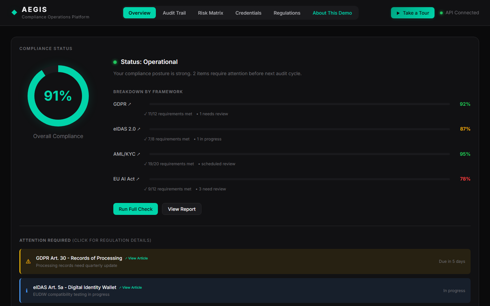

# Aegis: AI Compliance Operations Platform

<div align="center">


**A Claude agent that reviews systems against GDPR, eIDAS 2.0, AML/KYC and the EU AI Act, grounded in a library of real regulation articles, with deterministic PII checks and an audit trail.**

[](https://opensource.org/licenses/MIT)
[](https://aegis-web-xi.vercel.app/)
[](https://aegis-backend-ermb.onrender.com/api-docs)
[](https://github.com/dojedaro/aegis/actions)

[**Live Demo**](https://aegis-web-xi.vercel.app/) • [What It Does](#-what-it-does) • [Features](#features) • [Architecture](#architecture) • [Quick Start](#quick-start)

> **Note:** First API request may take ~30 seconds to initialize (free tier cold start)



</div>

---

## 🎯 What It Does

Compliance review means reading a system or document against many regulations, finding the articles
that apply, and recording each issue with a citation an auditor can check. Aegis does that with a
Claude agent whose tools do the parts that must be exact:

| Tool | What it does | Why it's a tool and not the model |
|---|---|---|
| `search_regulations` | BM25 retrieval over a curated library of regulation articles | Answers are grounded in real article text |
| `scan_pii` | Rule-based detection of personal data in an excerpt | Deterministic: the same input always gets the same result |
| `record_finding` | Records an issue with severity and the article it violates | Rejects a finding whose cited article doesn't exist, so citations can't be invented |

Around the agent sits a full application: explainable rule-based KYC risk scoring, an RBAC-protected
audit trail, JWT authentication, a dashboard, and a daily cap on AI requests for the public demo.

### Also a Claude Code extension

The repository also packages the same capabilities for Claude Code: slash-command skills, specialized
subagents, an MCP server exposing the compliance tools, and hooks that block PII and log every action.
This shows how domain guardrails can be enforced deterministically around an AI coding agent.

---

## ✨ Features

### AI Agent Architecture

| Component | Count | Purpose |
|-----------|-------|---------|
| **Skills** | 5 | Orchestrate complex compliance workflows |
| **MCP Tools** | 5 | Extend Claude with domain-specific capabilities |
| **Hooks** | 3 | Deterministic guardrails (PII blocking, audit logging) |
| **Subagents** | 4 | Role-specific prompts (regulatory analyst, risk assessor, audit documenter, security reviewer) |

### Specialized AI Subagents

| Agent | Expertise |
|-------|-----------|
| **Regulatory Analyst** | Multi-jurisdiction compliance (GDPR, eIDAS, AML, EU AI Act) |
| **Risk Assessor** | Likelihood × impact scoring, EDD recommendations |
| **Audit Documenter** | Audit-ready report generation |
| **Security Reviewer** | Privacy impact, vulnerability analysis |

### Compliance Capabilities

- **Regulatory Checking** — Analyze code against GDPR, eIDAS 2.0, AML/KYC, EU AI Act
- **Risk Assessment** — Score entities using standard risk matrices
- **Audit Trail** — Append-only evidence log; writes require an analyst/admin token and record the authenticated actor
- **Credential checks** — Structural checks of W3C Verifiable Credentials (required fields, expiry, proof present); signatures are not cryptographically verified yet
- **Incident Response** — Guided compliance incident workflows
- **PII Protection** — Automatic detection and blocking of sensitive data
- **RAG-Powered Q&A** — BM25 retrieval over 26 curated regulation articles; answers cite articles and link to EUR-Lex
- **Agentic Review** — Claude drives a tool loop whose tools do real work: regulation retrieval, deterministic PII scanning, and finding recording that rejects citations to articles that don't exist. The score is computed in code, not by the model
- **Explainable Risk Scoring** — Deterministic rule-based KYC/AML scoring (sanctions hit ⇒ critical), optionally refined by Claude with schema-validated structured output

---

## 🏗️ Architecture

```
┌─────────────────────────────────────────────────────────────┐
│                    User Interaction Layer                   │
│         CLI Commands  •  Web Dashboard  •  Skills           │
├─────────────────────────────────────────────────────────────┤
│                    AI Orchestration Layer                   │
│    ┌──────────────┐  ┌──────────────┐  ┌──────────────┐    │
│    │  Regulatory  │  │     Risk     │  │    Audit     │    │
│    │   Analyst    │  │   Assessor   │  │  Documenter  │    │
│    └──────────────┘  └──────────────┘  └──────────────┘    │
├─────────────────────────────────────────────────────────────┤
│                    Tool & Hook Layer                        │
│    MCP Tools: regulatory_check, audit_log, risk_score      │
│    Hooks: pii_scanner, audit_logger, compliance_gate       │
├─────────────────────────────────────────────────────────────┤
│                    Data Layer                               │
│    Regulations DB  •  Audit Trail  •  Risk Matrix          │
└─────────────────────────────────────────────────────────────┘
```

### Key Design Decisions

1. **Skills as orchestrators** — Each skill coordinates multiple tools and can spawn specialized subagents
2. **Hooks for guardrails** — Deterministic checks that run before/after AI operations
3. **MCP for extensibility** — Custom tools that give Claude domain-specific capabilities
4. **Subagents for expertise** — Deep domain knowledge encoded in specialized prompts

### Tech Stack

| Layer | Built with |
|---|---|
| AI | Claude API (`@anthropic-ai/sdk`), Claude Sonnet 5.5 by default (set `AEGIS_MODEL` to change it), with server-side refusal fallbacks; MCP server (`@modelcontextprotocol/sdk`) exposing compliance tools |
| Backend | Node.js, Express, TypeScript, Zod validation, SQLite (sql.js), JWT auth, Helmet, rate limiting, Swagger/OpenAPI docs |
| Frontend | TypeScript + Vite (no framework), deployed on Vercel |
| Quality | Vitest (backend), Playwright (end-to-end), GitHub Actions CI, Docker Compose |
| Hosting | Render (API) and Vercel (web); deploys run from `main` |

---

## 🚀 Quick Start

### Prerequisites

- Node.js 18+
- npm 9+
- Claude Code CLI

### Installation

```bash
git clone https://github.com/dojedaro/aegis.git
cd aegis
npm install
npm run build
```

### Try It Out

**Web Dashboard:**
```bash
cd web && npm run dev
# Open http://localhost:5173
```

**CLI Demo:**
```bash
cd cli && npm run demo
```

**Backend API (Local):**
```bash
cd backend && npm install && npm run dev
# API running at http://localhost:3001
```

**Live Deployments (No Setup Required):**
- **Frontend:** https://aegis-web-xi.vercel.app
- **Backend API:** https://aegis-backend-ermb.onrender.com
- **API Docs:** https://aegis-backend-ermb.onrender.com/api-docs

**Docker (Full Stack):**
```bash
docker-compose up -d
# Web: http://localhost:5173
# API: http://localhost:3001
```

**Claude Code Skills:**
```bash
cd aegis

# Run compliance check
/compliance-check examples/sample-kyc-flow/customer-data.json

# Assess risk
/risk-assess customer:C-12345 --type customer

# Verify credential
/credential-verify ./examples/sample-kyc-flow/customer-data.json
```

---

## 📁 Project Structure

```
aegis/
├── .claude/
│   ├── skills/              # 5 invocable workflows
│   │   ├── compliance-check.md
│   │   ├── audit-report.md
│   │   ├── risk-assess.md
│   │   ├── credential-verify.md
│   │   └── incident-respond.md
│   └── hooks.json           # Hook definitions
│
├── hooks/
│   ├── pii-scanner.js       # Blocks PII before file writes
│   ├── audit-logger.js      # Logs all operations
│   └── compliance-gate.js   # Validates commits
│
├── mcp-server/
│   └── src/
│       ├── tools/           # 5 MCP tools
│       └── resources/       # 2 resource providers
│
├── subagents/               # 4 AI specialist prompts
│   ├── regulatory-analyst.md
│   ├── risk-assessor.md
│   ├── audit-documenter.md
│   └── security-reviewer.md
│
├── backend/                 # Express API with SQLite
│   ├── src/
│   │   ├── routes/          # REST API endpoints
│   │   ├── services/        # Claude AI, RAG services
│   │   └── db/              # SQLite schema & migrations
│   ├── tests/               # Vitest unit tests
│   └── Dockerfile           # Production container
│
├── cli/                     # Interactive CLI
├── web/                     # Dashboard UI
│   ├── e2e/                 # Playwright e2e tests
│   └── Dockerfile           # Production container
│
├── .github/workflows/       # CI/CD pipelines
├── docker-compose.yml       # Full stack deployment
└── examples/                # Sample data & workflows
```

---

## 🔧 Skills Reference

| Skill | Command | What It Does |
|-------|---------|--------------|
| **Compliance Check** | `/compliance-check <file>` | Scans for PII, analyzes against regulations, spawns Regulatory Analyst for deep review |
| **Audit Report** | `/audit-report --period month` | Queries audit trail, spawns Audit Documenter, generates formatted report |
| **Risk Assessment** | `/risk-assess <entity>` | Calculates risk scores, spawns Risk Assessor, provides EDD recommendations |
| **Credential Verify** | `/credential-verify <file>` | Structural checks of W3C VCs (fields, expiry, proof present, issuer in a demo allowlist), mapped to eIDAS requirements; signatures not verified |
| **Incident Response** | `/incident-respond --severity high` | Guides incident workflow, spawns Security Reviewer, generates documentation |

---

## 🛡️ Hooks (Automated Guardrails)

| Hook | Trigger | Action |
|------|---------|--------|
| **PII Scanner** | Before Edit/Write | Blocks SSN, credit cards, API keys — prevents accidental data exposure |
| **Audit Logger** | After all tools | Appends every tool call to an audit trail for compliance evidence |
| **Compliance Gate** | Before git commit | Scans staged files for secrets, validates audit trail currency |

---

## 📊 Example Output

> Illustrative output format from the skill templates, not a saved run.

### Compliance Check
```
/compliance-check src/services/user.ts

✓ PII Scan: No sensitive data detected
✓ GDPR Analysis: 11/12 requirements met
⚠ AML-001: Customer Due Diligence needs verification

Spawning Regulatory Analyst for detailed review...

Findings:
┌──────────┬──────────┬─────────────────────────────────┐
│ ID       │ Severity │ Recommendation                  │
├──────────┼──────────┼─────────────────────────────────┤
│ AML-001  │ HIGH     │ Add explicit CDD step before    │
│          │          │ customer data processing        │
└──────────┴──────────┴─────────────────────────────────┘
```

### Risk Assessment
```
/risk-assess customer:C-12345 --type customer

Risk Factors:
• Cross-border transfers    L:4 × I:4 = 16 (HIGH)
• PEP exposure             L:2 × I:5 = 10 (HIGH)
• Transaction volume       L:3 × I:3 = 9  (MEDIUM)

Overall: 14/25 — HIGH RISK

Regulatory Implications:
→ AML: Apply Enhanced Due Diligence
→ Monitoring: Monthly transaction review required
```

---

## 🔌 Backend API

The backend provides a REST API with real Claude AI integration.

### API Documentation

Interactive API documentation is available via Swagger UI:

```bash
cd backend && npm run dev
# Open http://localhost:3001/api-docs
```

Features:
- **OpenAPI 3.0** specification with full schema definitions
- **Interactive testing** - Try endpoints directly in the browser
- **Authentication** - JWT Bearer tokens (HS256) with role-based access control
- **Request correlation IDs** - Every request gets a unique `x-request-id` for tracing

### Endpoints

| Endpoint | Method | Description |
|----------|--------|-------------|
| `/api/auth/login` | POST | Get JWT access token |
| `/api/auth/demo-token` | POST | Get a read-only (viewer) demo token |
| `/api/auth/me` | GET | Get current user info |
| `/api/audit` | GET | Audit trail (filter by period/type) |
| `/api/audit` | POST | Append an audit entry (**analyst/admin**) |
| `/api/audit/actions/export` | GET | JSON/CSV export (**analyst/admin**) |
| `/api/compliance/check` | POST | Run compliance analysis |
| `/api/risk/assess` | POST | Risk assessment with scoring |
| `/api/credentials/verify` | POST | Verify W3C credentials |
| `/api/pii/scan` | POST | Scan for PII patterns |
| `/api/pii/redact` | POST | Redact PII from content |
| `/api/regulations/search` | POST | BM25 search across regulations |
| `/api/regulations/query` | POST | RAG-powered Q&A about regulations |
| `/api/agent/analyze` | POST | Agentic compliance review (tool use) |
| `/api/agent/risk` | POST | AI risk assessment (structured output) |

### Authentication

Demo credentials for the fictional "The Safe Company" (demo only; a real deployment would use an identity provider):
```
admin@safeco.com / admin123    (admin role)
analyst@safeco.com / analyst123 (analyst role)
viewer@safeco.com / viewer123   (viewer role)
demo@safeco.com / demo         (analyst role)
```

Read endpoints are public for the live demo. Writing to or exporting the audit trail requires an `analyst` or `admin` token, and the entry's actor is always taken from the token. In production the server refuses to start without `JWT_SECRET`.

### AI Features (Optional)

Set `ANTHROPIC_API_KEY` environment variable to enable:
- Intelligent compliance analysis
- AI-powered PII detection
- RAG-based regulation Q&A

Every AI-backed response says where it came from (`source` / `answer_source` / `mode`): `claude`, `cache`, `rules`, `extractive` or `demo`. Without an API key the API runs in clearly labeled demo mode. If a model call fails, the request fails (or falls back to the deterministic result and says so); it never substitutes made-up findings. AI endpoints have a separate per-IP rate limit.

```bash
# .env
ANTHROPIC_API_KEY=sk-ant-...
```

---

## 🐳 Docker

Run the full stack with Docker:

```bash
# Build and start all services (JWT_SECRET is required in production mode)
JWT_SECRET=$(openssl rand -hex 32) docker-compose up -d

# View logs
docker-compose logs -f

# Stop services
docker-compose down
```

Services:
- **aegis-web** - Dashboard on port 5173
- **aegis-backend** - API on port 3001

---

## 📊 Results and Quality

**Agent evaluation** ([`backend/eval/`](backend/eval/), run with `npm run eval` in `backend/`): 11 short
system descriptions, 9 with planted violations (14 in total) and 2 clean controls, each violation mapped
to the regulation articles that correctly identify it. Scored in code, Claude Sonnet 5.5, one run:

| Measure | Result |
|---|---|
| Planted violations found | **14 / 14** |
| Findings on the 2 clean controls (false alarms) | **0** |
| Findings citing an article that wasn't planted | 6 of 23 |

I read the 6 extra findings and judged all of them defensible additional issues (for example a missing
DPIA for large-scale biometric processing), not errors. Caveats: the cases are short and were written by
the same person who built the agent, it is one run, and 14 violations is a small sample, so this shows the
agent works on clear cases, not how it does on messy real documents. Scoring checks the article a finding
cites, not its text, and some violations accept either of two related articles; the clean controls are
easy negatives that state the compliant practice outright.

- **76 backend tests pass in about 5 seconds with no API key** (9 files: routes for AI, compliance,
  PII and security; the agent, LLM, RAG and risk-rule services; and a check that the web app's
  regulation library matches the one the agent cites). Tests inject a fake Claude
  client, so the suite never spends money; without a key the app itself runs in demo mode
  (extractive answers and rule-based checks).
- **17 Playwright end-to-end tests** cover the dashboard.
- **Cost guardrail:** the live AI endpoints share a daily request cap (`AI_DAILY_REQUEST_LIMIT`,
  default 1,000), so a public demo can't run up an unbounded bill.

## 🧪 Testing

### Backend Tests (Vitest)
```bash
cd backend
npm test                 # Run tests
npm run test:coverage    # With coverage report
```

### E2E Tests (Playwright)
```bash
cd web
npm run test:e2e         # Run e2e tests
npm run test:e2e:ui      # Interactive UI mode
```

---

## 📸 Live Demo

<div align="center">

**[View Live Demo →](https://aegis-web-xi.vercel.app)**

The live dashboard includes:
- **Compliance Dashboard** — Compliance status across GDPR, eIDAS 2.0, AML/KYC, and EU AI Act (sample data)
- **Risk Matrix** — Interactive likelihood × impact visualization
- **Audit Trail** — Compliance event log with filtering and export
- **Credential Verification** — W3C Verifiable Credential validation
- **Regulation Search** — RAG-powered Q&A about regulatory requirements

**[Try the API →](https://aegis-backend-ermb.onrender.com/api-docs)**

</div>

---

## 📁 Sample Data

The `examples/` folder contains realistic synthetic data for testing:

| File | Description |
|------|-------------|
| `customers.json` | 6 customer profiles (individuals & corporates) with varying risk levels |
| `audit-entries.json` | 12 audit trail entries covering all operation types |
| `credentials.json` | 5 W3C Verifiable Credentials (identity, address, education, employment) |
| `risk-assessments.json` | 4 complete risk assessments with factor breakdowns |
| `customer-data.json` | Full KYC flow example with documents and screening results |

---

## ⚠️ Limitations

- **Credential signatures are not verified.** The verify endpoint checks required fields and expiry and
  reports the signature and issuer trust as *not checked*. Real verification (a trust registry of issuer
  keys and Ed25519 signature checks) is the next step.
- **The agent evaluation is small** (11 author-written cases, one run). Real documents, cases written by
  someone else and repeated runs would make it a benchmark.

- **Demo data, not a customer deployment.** Compliance percentages, audit events and credentials come
  from seeded sample data (see the note below); the scores show how the platform reports, not a real
  organization's posture.
- **Regulatory answers need review.** The RAG search grounds answers in stored regulation text, but it
  is a research aid, not legal advice.
- **SQLite on the API host's disk.** Render's free tier has an ephemeral disk, so demo data resets on
  each deploy; production would use a managed database.

## 🔗 Links

- **Live Demo (Frontend):** https://aegis-web-xi.vercel.app/
- **Live API (Backend):** https://aegis-backend-ermb.onrender.com
- **API Documentation:** https://aegis-backend-ermb.onrender.com/api-docs
- **GitHub:** https://github.com/dojedaro/aegis
- **LinkedIn:** https://www.linkedin.com/in/dojedaro

---

## 📝 Note on Data

This project uses **synthetic data** for demonstration. "The Safe Company" is fictional. No real personal data, proprietary information, or production systems are involved.

---

<div align="center">

### Built by [Daniel Ojeda](https://github.com/dojedaro)

**AI Enabler** — Transforming complex workflows with intelligent automation

[](https://github.com/dojedaro)
[](https://www.linkedin.com/in/dojedaro)

</div>
