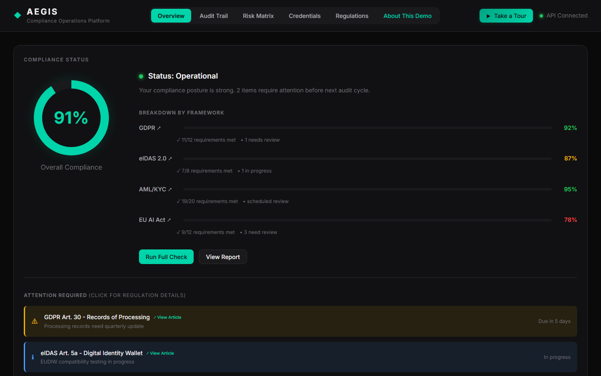
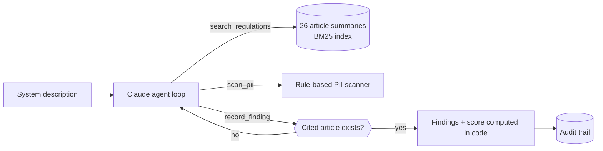

# Aegis: an AI compliance reviewer that has to cite its sources

<div align="center">

**A Claude agent that reviews a system description against GDPR, eIDAS 2.0, AML/KYC and the EU AI Act. Every finding must cite an article from a curated regulation library, PII checks are deterministic, and every action lands in an audit trail.**

[](https://opensource.org/licenses/MIT)
[](https://aegis-web-xi.vercel.app/)
[](https://aegis-backend-ermb.onrender.com/api-docs)
[](https://github.com/dojedaro/aegis/actions)

[**Live demo**](https://aegis-web-xi.vercel.app/) · [How it works](#how-it-works) · [Results](#results-and-quality) · [Limitations](#limitations) · [Run it](#run-it)

> The API is on a free tier: the first request can take about 30 seconds to wake it up.



</div>

## The problem

A compliance review means reading a system or document against several regulations, finding the
articles that apply, and writing down each issue with a citation an auditor can check. A language
model is good at the reading and poor at the parts that must be exact: it can invent an article
number, and it can miss a card number on one run and catch it on the next. Aegis gives the model
the reading and gives code the exact parts.

## How it works



| Tool | What it does | Why it is code and not the model |
|---|---|---|
| `search_regulations` | BM25 retrieval over a curated library of 26 article summaries (GDPR, eIDAS 2.0, AML, EU AI Act), each linked to the official text on EUR-Lex | The agent can only cite what retrieval returned |
| `scan_pii` | Rule-based detection of personal data in an excerpt | The same input always gets the same result |
| `record_finding` | Records an issue with a severity and the article it violates | Rejects a finding whose article id is not in the library, so citations cannot be invented |

The compliance score is computed in code from the recorded findings, not written by the model.

Around the agent sits a small application: rule-based KYC risk scoring that explains each factor
(optionally refined by Claude with schema-validated output), an append-only audit trail behind
JWT role checks, regulation Q&A with citations, a dashboard, and a daily cap on AI requests so the
public demo cannot run up a bill. Every AI-backed response says where it came from (`claude`,
`cache`, `rules`, `extractive` or `demo`); without an API key the app runs in labelled demo mode,
and a failed model call is reported as a failure, never replaced with made-up findings.

## Results and quality

**Agent evaluation** ([`backend/eval/`](backend/eval/), run with `npm run eval` in `backend/`): 11 short
system descriptions, 9 with planted violations (14 in total) and 2 clean controls, each violation mapped
to the regulation articles that correctly identify it. Scored in code, Claude Sonnet 5.5, one run:

| Measure | Result |
|---|---|
| Planted violations found | **14 / 14** |
| Findings on the 2 clean controls (false alarms) | **0** |
| Findings citing an article that wasn't planted | 6 of 23 |

I read the 6 extra findings and judged all of them defensible additional issues (for example a missing
DPIA for large-scale biometric processing), not errors. Caveats: the cases are short and were written by
the same person who built the agent, it is one run, and 14 violations is a small sample, so this shows the
agent works on clear cases, not how it does on messy real documents. Scoring checks the article a finding
cites, not its text, and some violations accept either of two related articles; the clean controls are
easy negatives that state the compliant practice outright.

- **80 backend tests pass in about 5 seconds with no API key** (10 files: routes for AI, compliance,
  PII and security; the agent, LLM, RAG, risk-rule and credential-check services; and a check that the web app's
  regulation library matches the one the agent cites). Tests inject a fake Claude
  client, so the suite never spends money; without a key the app itself runs in demo mode
  (extractive answers and rule-based checks).
- **17 Playwright end-to-end tests** cover the dashboard (`npm run test:e2e` in `web/`; run locally, not in CI).
- **7 hook tests** pipe real Claude Code payloads into the hooks and check the exit codes (`npm run test:hooks`).
- **Cost guardrail:** the live AI endpoints share a daily request cap (`AI_DAILY_REQUEST_LIMIT`,
  default 1,000), so a public demo can't run up an unbounded bill.

## Limitations

- **The regulation library is summaries, not full legal text.** Each of the 26 entries is a
  one-paragraph summary of an article with a link to EUR-Lex. Retrieval over the full article text
  is the next step, and would need the evaluation rerun.
- **The agent evaluation is small** (11 author-written cases, one run). Real documents, cases written
  by someone else and repeated runs would make it a benchmark.
- **Credential signatures are not verified.** The verify endpoint checks required fields and expiry
  and reports the signature and issuer trust as *not checked*.
- **PII rules are regular expressions** tuned for US and generic formats (SSN, cards, IBAN, email,
  phone). National ID formats for EU member states and Korea are not covered.
- **Demo data, not a customer deployment.** Compliance percentages, audit events and credentials come
  from seeded synthetic data for a fictional company; no real personal data is involved.
- **Not legal advice.** Answers are a research aid and need review by a qualified person.
- **SQLite on an ephemeral disk.** Demo data resets on each deploy; production would use a managed
  database.

## Run it

Requires Node.js 20+.

```bash
git clone https://github.com/dojedaro/aegis.git
cd aegis
npm install                                  # web, CLI and MCP server workspaces

cd backend && npm install && npm run dev     # API on http://localhost:3001 (docs at /api-docs)
cd web && npm run dev                        # dashboard on http://localhost:5173
```

Set `ANTHROPIC_API_KEY` in `backend/.env` to use Claude (Sonnet 5.5 by default; `AEGIS_MODEL`
overrides it). Without a key everything runs in demo mode.

```bash
cd backend && npm test          # 80 tests, no API key needed
cd backend && npm run eval      # the agent evaluation (needs an API key)
npm run test:hooks              # 7 hook tests, from the repo root
cd web && npm run test:e2e      # Playwright
```

Docker, full stack (the compose file refuses to start without a JWT secret):

```bash
JWT_SECRET=$(openssl rand -hex 32) docker-compose up -d
```

The demo logins and the full endpoint list are in the [API docs](https://aegis-backend-ermb.onrender.com/api-docs).
Read endpoints are public for the demo; writing to or exporting the audit trail needs an `analyst`
or `admin` token, and the entry's actor is always taken from the token.

## Also packaged for Claude Code

The same guardrails are set up for Claude Code in this repository, so they apply while an AI
coding agent works on compliance-sensitive code:

| Piece | Where | What it does |
|---|---|---|
| 3 hooks | [`hooks/`](hooks/), registered in [`.claude/settings.json`](.claude/settings.json) | `pii-scanner` blocks an Edit or Write that contains PII (exit code 2); `compliance-gate` scans staged files for secrets before a `git commit`; `audit-logger` appends every tool call to the audit trail |
| 5 skills | [`.claude/skills/`](.claude/skills/) | `/compliance-check`, `/risk-assess`, `/audit-report`, `/credential-verify`, `/incident-respond` |
| 4 subagents | [`.claude/agents/`](.claude/agents/) | Regulatory analyst, risk assessor, audit documenter, security reviewer |
| MCP server | [`mcp-server/`](mcp-server/), registered in [`.mcp.json`](.mcp.json) | `regulatory_check`, `risk_score`, `pii_detect`, `credential_validate`, `audit_log` |

The hooks are tested with the payloads Claude Code sends. The skills and subagents are prompt
definitions and have no evaluation of their own; the measured part of this project is the API
agent above.

## Stack

| Layer | Built with |
|---|---|
| AI | Claude API (`@anthropic-ai/sdk`) with tool use and structured output; MCP server (`@modelcontextprotocol/sdk`) |
| Backend | Node.js, Express, TypeScript, Zod, SQLite (sql.js), JWT auth, Helmet, rate limiting, OpenAPI docs |
| Frontend | TypeScript and Vite, no framework |
| Quality | Vitest, Playwright, `node:test` for hooks, GitHub Actions |
| Hosting | Render (API) and Vercel (web), deployed from `main` |

## Layout

```
backend/        Express API: agent, retrieval, risk rules, auth, audit trail, eval
web/            Dashboard (Vite) and Playwright tests
mcp-server/     MCP server exposing the compliance tools
cli/            Terminal demo
hooks/          Claude Code hooks and their tests
.claude/        Hook registration, skills, subagents
examples/       Synthetic customers, credentials and audit entries
```

---

Built by [Daniel Ojeda](https://github.com/dojedaro) · [LinkedIn](https://www.linkedin.com/in/danielojedar) · MIT license
